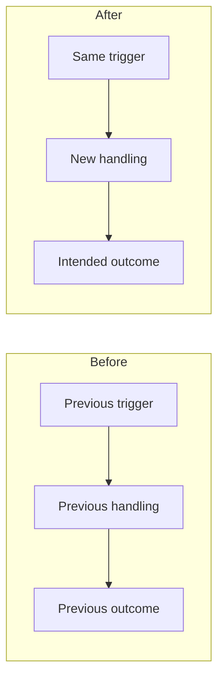

> Replace the bracketed prose with the details of this change, then remove this note.
> Write for someone who has not followed the conversation or read the diff. Keep the
> explanation proportional to the change and remove sections that do not apply.
> CI reports check status; this description explains the behavior and design.
> Use visuals where they carry the explanation: UI changes require before/after
> screenshots, interaction or motion changes require a short recording, and changes to
> multi-step flows, state transitions or component relationships require a Mermaid
> diagram when those relationships are material to understanding the change.

## Intent and context

This PR [describe the intended outcome and who benefits]. Currently, [explain the
existing behavior and why it falls short]. When [give a concrete trigger or example],
[describe the consequence that motivates the change].

The change needs to [explain the important constraints or requirements]. [Link the
relevant issue or accepted architecture decision and explain its connection, if any.]

## Resulting behavior

With this change, [describe what someone can now do or observe]. For example,
[walk through the main flow, contrasting the previous result with the new one]. If
[describe a meaningful failure condition], [explain the resulting behavior and recovery].

[Explain any changed defaults, effects on existing workflows and deliberate scope
limits. For an internal change, describe the resulting capability or invariant.]

### Before and after

[For UI changes, embed actual captures of the affected state below, using comparable
data, viewport and theme. Add a brief caption explaining what to notice. Add pairs for
other materially different states when needed. Upload review-only assets without
committing them. If capture is blocked, explain the limitation; a diagram or mockup
does not substitute for a screenshot of the app. Remove this subsection for changes
with no visible UI effect.]

| Before                             | After                             |
| ---------------------------------- | --------------------------------- |
| [Embed the before screenshot here] | [Embed the after screenshot here] |
| [Explain the previous behavior]    | [Explain the resulting behavior]  |

[Embed a short recording here when the change involves interaction, motion or timing,
and explain which part demonstrates the change. Remove this paragraph otherwise.]

## How it works

[Name the component or service that owns the behavior] now [explain its responsibility].
When [describe the initiating action], [follow the request or data through the relevant
components to the final result]. [Explain where state lives and how it is updated.]

[Explain how the substantial parts of the implementation fit together and why each is
needed. Cover contracts, persistence and resource ownership where relevant. Use source
links to support the explanation rather than listing changed files.]

### Flow of the change

[For changes whose explanation depends on multi-step flow, state transitions or
component relationships, replace this example with a Mermaid flowchart, sequence or
state diagram of the actual implementation. Show before and after when the relationship
or sequence changed; otherwise show the new flow. Label the important boundaries and
failure or recovery paths, then explain the key difference in a sentence. Keep the
diagram small enough to read. Remove this subsection when there is no meaningful flow
or relationship to illustrate.]

[Explain how the illustrated change produces the intended outcome.]

## Decisions and rationale

The implementation uses [describe a consequential approach] because [explain the
constraint it addresses and why it fits the codebase and user experience]. [Describe a
credible alternative, if relevant] would [explain its consequences], making it less
suitable here because [give the reason].

[Repeat for other consequential decisions, including new abstractions, dependencies,
schema changes or departures from existing patterns. Distinguish requirements from
implementation judgment; omit routine syntax choices and invented alternatives.]

## Trade-offs and limitations

This approach [explain the benefit] at the cost of [describe the accepted complexity or
resource cost]. That trade-off is reasonable because [explain why the benefit warrants
the cost in this context].

[Describe known limitations, unsupported cases and remaining uncertainty. Address
performance, memory, storage, responsiveness, maintainability, privacy or model usage
where affected. Support quantitative claims with measurements and their conditions,
and distinguish observed results from expectations.]

## Compatibility and lifecycle

[Explain how existing stored data, contracts and supported clients are affected and
how existing state reaches the new behavior]. During [describe cancellation,
interruption, restart or another relevant transition], [explain what is retained,
released or recovered and why].

[Call out irreversible effects, deployment ordering or recovery constraints when they
exist. Remove this section when the change has no meaningful compatibility or lifecycle
implications.]

## Review focus and follow-up

The main point for review is [identify a decision or assumption that needs judgment],
because [explain what depends on it and what the reviewer should consider].

[Describe any deliberately deferred work, why it is separate and whether this change
is complete without it. Link existing tracking issues or architecture decisions where
useful. Remove this section when there is no specific review focus or follow-up.]
